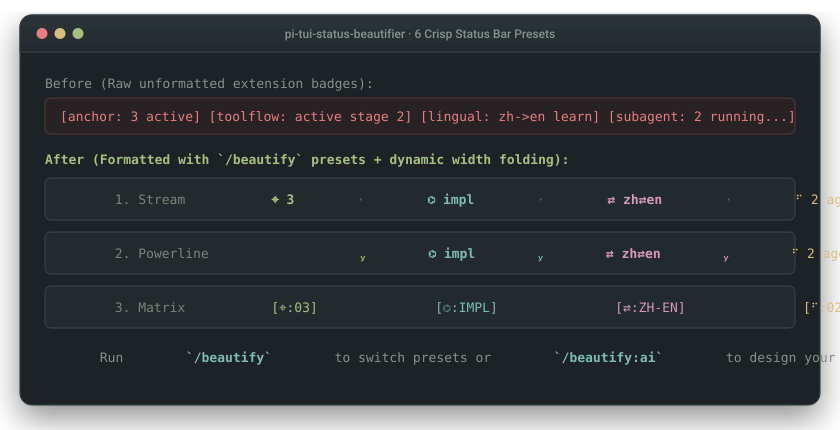

# pi-tui-status-beautifier

Minimalist status bar formatter & layout engine for Pi TUI.

Clean up fragmented extension status strings. Enjoy adaptive narrow-terminal folding and zero render-loop disk I/O, with zero telemetry hijacking.

[](https://www.npmjs.com/package/pi-tui-status-beautifier)
[](https://www.npmjs.com/package/pi-tui-status-beautifier)
[](https://github.com/3ZEROS12/pi-tui-status-beautifier/stargazers)
[](https://github.com/earendil-works/pi-coding-agent)
[-brightgreen)](extensions/tui-status-beautifier.spec.ts)
[](LICENSE)

**English** | [日本語](./README_ja.md) | [简体中文](./README_zh.md)

<p align="center">
  
</p>

```text
  ┌─ Native Status Bar (Fragmented & Cluttered) ────────────────────────────────────────────────────────┐
  │  plannotator: 🟢 3 tasks    pi-mcp-adapter: [connected]    toolflow: active (2/5)    anchor: 3 items │
  └─────────────────────────────────────────────────────────────────────────────────────────────────────┘
                                                    │
                                                    ▼
  ┌─ pi-tui-status-beautifier (Normalized, Coherent & Adaptive) ────────────────────────────────────────┐
  │  plan ❯ ◆ 3    mcp ❯ ● ready    toolflow ❯ ⌬ 2/5    anchor ❯ ⌖ 3    chrome ❯ ● connected            │
  └─────────────────────────────────────────────────────────────────────────────────────────────────────┘
```

## Quick Start

Install directly inside Pi:

```bash
pi install npm:pi-tui-status-beautifier
```

Takes effect immediately. Type `/beautify` anytime to switch styles interactively.

---

## Core Value: Why Do Developers Need This?

As the Pi extension ecosystem grows, developers routinely install multiple tools (`plannotator`, `pi-mcp-adapter`, `toolflow`, `pi-anchor`, `pi-lingual`). The status bar quickly runs into four frictions:

### 1. Inconsistent Syntax & Visual Clutter
Every extension authors status text independently. Some prefix long package names (`pi-mcp-adapter:`), some wrap counts in brackets (`[2]`), and others dump raw emojis. Inconsistent character metrics create visual distraction at the bottom of your screen.
`pi-tui-status-beautifier` strips package suffixes and normalizes raw text into uniform, structured micro-badges.

### 2. Narrow Terminal Line Wrapping
In split-pane layouts (tmux, WezTerm, or windows `< 80` columns), long status strings wrap onto multiple lines, shoving your prompt up and down and breaking typing flow.
The built-in column budget guard automatically collapses idle badges into `(+3 idle)` when width tightens, prioritizing errors and running tasks.

### 3. Never Hijacks Platform Telemetry
Many status bar plugins take a heavy-handed approach: completely replacing Pi's native footer via `ctx.ui.setFooter`. In doing so, they wipe out essential system metrics—git branches, token counts (`↑1.2k ↓3.4k`), cache read rates, and thinking levels (`• high`).
This extension defaults to a **non-intrusive micro-hook (`status-only`)**: it normalizes extension badges while leaving Pi's native system telemetry 100% intact.

### 4. Zero Render-Loop Disk I/O
Reading configuration files synchronously inside high-frequency TUI animation redraw loops causes disk contention and sluggish typing.
This extension loads settings into memory at startup and uses dirty-checking caches, performing **zero synchronous file reads** during TUI redraws.

---

## How It Works: The Action Matrix

```text
  /beautify (Open interactive theme switcher anytime)
```

| Mode / Scenario | What You Do | What the Beautifier Does | What You See | Best For |
| :--- | :--- | :--- | :--- | :--- |
| **`stream`** *(Default)* | Install extensions normally | Strips package prefixes and normalizes badges | `plan ❯ ◆ 3  mcp ❯ ● ready  anchor ❯ ⌖ 3` | Minimalist everyday pairing |
| **Narrow Split Panes** | tmux split width `< 80` cols | Preserves active badges, condenses idle items | `toolflow ❯ ⌬ running (2/5)  (+3 idle)` | Split panes without line wrap |
| **`full-footer`** *(Panorama)* | Enable full footer mode | Formats unified two-line layout | Line 1: Git/Token/Model; Line 2: Normalized badges | Geek panoramic overview |
| **`off`** *(Clean Revert)* | Run `/beautify off` | Physically deletes `beautifier` key from `settings.json` | 100% native unformatted status bar, 0 residue | Zero-regret testing |

---

## Preset Gallery & Visual Themes

Type `/beautify` to switch styles interactively:

```text
  1. stream (Default Minimalist Stream)
     chrome ❯ ● ready    toolflow ❯ ⌬ 2/5    anchor ❯ ⌖ 3    plan ❯ ◆ 1

  2. nord (Angled Brackets & Distinct Glyphs)
     chrome ‹◆ ready›    toolflow ‹◈ 2/5›    anchor ‹⌖ 3›    plan ‹◆ 1›

  3. tokyo (Midnight Brackets & Star Accents)
     chrome ⦗✦ ready⦘    toolflow ⦗✧ 2/5⦘    anchor ⦗⌖ 3⦘    plan ⦗✦ 1⦘

  4. glow (High-Contrast Inverse Pill Badges)
     chrome [ ● ready ]  toolflow [ ⌬ 2/5 ]  anchor [ ⌖ 3 ]  plan [ ◆ 1 ]

  5. minimal (Fixed 10-Column Aligned Stream)
     chrome     ❯ ● ready    toolflow   ❯ ⌬ 2/5    anchor     ❯ ⌖ 3

  6. custom (AI-Assisted Co-Design)
     Describe your aesthetic in plain text; your agent generates 3 ASCII mockups.
```

---

## Engineering Highlights

- 🛡️ **Non-Destructive Dual Scopes**:
  * `status-only` (Default & Recommended): Only hooks `ctx.ui.setStatus` badges. Preserves Pi's native Git branch, working directory, token counts, and thinking levels 100% untouched.
  * `full-footer`: Formats the entire bottom bar with system telemetry on line 1 and badges on line 2.
- 📐 **Unicode UAX #11 & Surrogate-Pair Safety**: Built-in character scanner accurately measures East Asian Wide (2 cols), ASCII (1 col), and ANSI escape codes (0 cols), eliminating cursor jitter and column misalignments.
- ⚡ **Zero Render-Loop Disk I/O**: Loads configuration once into memory. Redraw loops perform zero synchronous disk reads (`fs.readFileSync`), using dirty-checking to skip duplicate renders.
- ◐ **Terminal Micro-Spinners**: Active background tasks (`running`, `working`) trigger a smooth 300ms spinner (`◐`, `◓`, `◑`, `◒`).
- 🗑️ **Zero-Trace Physical Cleanup (`off`)**: Turning the extension off restores all original status strings and deletes the `beautifier` block from `settings.json`, leaving zero orphaned configuration behind.

---

## Commands & Configuration

### Interactive Command
```bash
/beautify                # Open interactive style picker
/beautify stream         # Switch directly to stream preset
/beautify off            # Revert to native status bar and delete config
```

### Settings Schema
Preferences persist in `./.pi/settings.json` (project-level) or `~/.pi/agent/settings.json` (global):

```json
{
  "beautifier": {
    "style": "stream",
    "fullFooter": false
  }
}
```

---

## Author's Note

The inspiration behind `pi-tui-status-beautifier` comes from daily aesthetic frustration: visual noise.

As I installed more extensions for Pi, the bottom status bar turned into a chaotic billboard. Every extension author used their own punctuation, raw emojis, and arbitrary string widths. In split-pane tmux or compact windows, lines wrapped awkwardly and the screen constantly flickered.

When I looked into existing status bar plugins, many took a sledgehammer approach: completely replacing Pi's native footer via `ctx.ui.setFooter`. In doing so, they wiped out essential platform metrics—token usage, cache read rates, thinking levels, and git branches. Even worse, some plugins read configuration files synchronously inside the animation redraw loop, causing typing sluggishness.

I built this beautifier around three strict constraints:
1. **Never hijack native telemetry**: Normalize extension badges while keeping system metrics untouched.
2. **Zero render-loop disk reads**: Memory-cached configuration with dirty-checking.
3. **Zero-trace revert**: Turning it off physically deletes the config block (`delete config.beautifier`).

A good status bar should be quiet, balanced, and invisible until you need it.

---

## Verification & Testing

```bash
npm run check       # typecheck + lint + 45 Vitest unit tests, all green
```

---

## Ecosystem: Pi Terminal Suite

Each extension occupies a distinct terminal slot (`aboveEditor`, `belowEditor`, `status-only` footer, and runtime tool hooks) so all four run together with zero widget overlap:

| Package | Terminal Slot & Mechanism | Install |
| :--- | :--- | :--- |
| **[`pi-lingual`](https://github.com/3ZEROS12/pi-lingual)** | `二 ⇄ two` `aboveEditor` HUD (≤9 lines, UAX #11 tree layout) & prompt-to-English transformer (0 chat history tokens) | `pi install npm:pi-lingual` |
| **[`toolflow`](https://github.com/3ZEROS12/toolflow)** | `⌬` Runtime tool hooks — stage-gated MCP mounting & >40-line log dehydration to disk (-95% log tokens) | `pi install npm:toolflow` |
| **[`pi-tui-status-beautifier`](https://github.com/3ZEROS12/pi-tui-status-beautifier)** *(Current)* | `status-only` footer hook — 6 badge presets, `<80`-col idle folding `(+N idle)`, 0 render-loop disk reads | `pi install npm:pi-tui-status-beautifier` |
| **[`pi-anchor`](https://github.com/3ZEROS12/anchor)** | `⌖` `belowEditor` 1-line sticky strip, 0ms `pin:` intercept, `[■■□□]` step bar & `↪` session jump | `pi install npm:pi-anchor` |

---

## License

MIT © [Jason](https://github.com/3ZEROS12)
